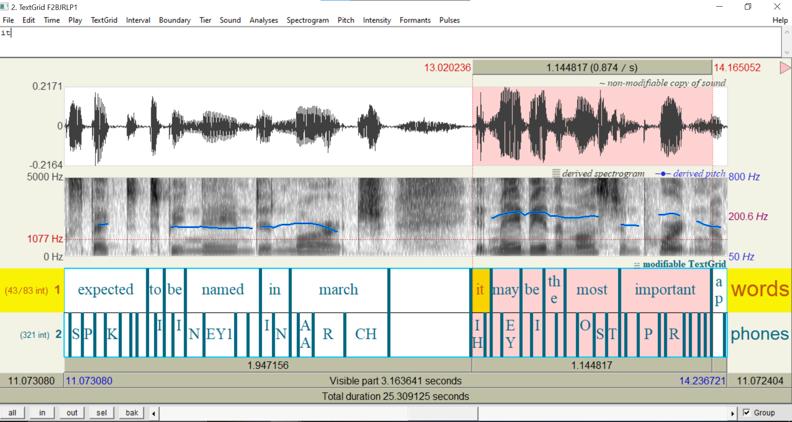
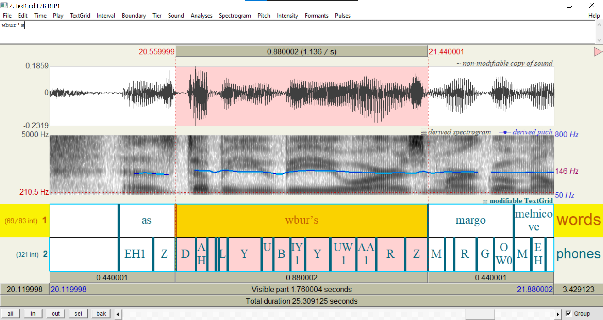
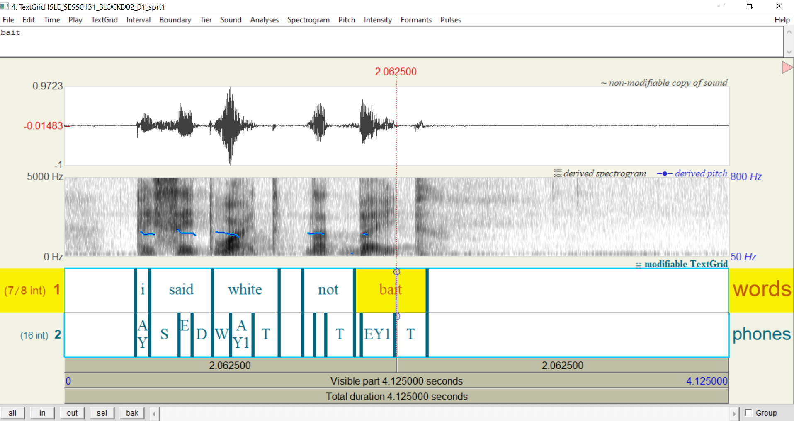
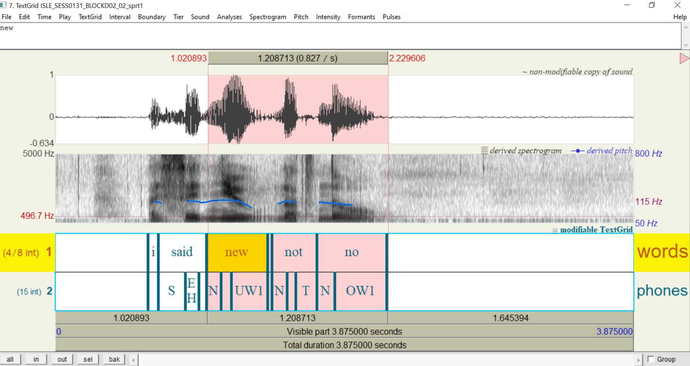
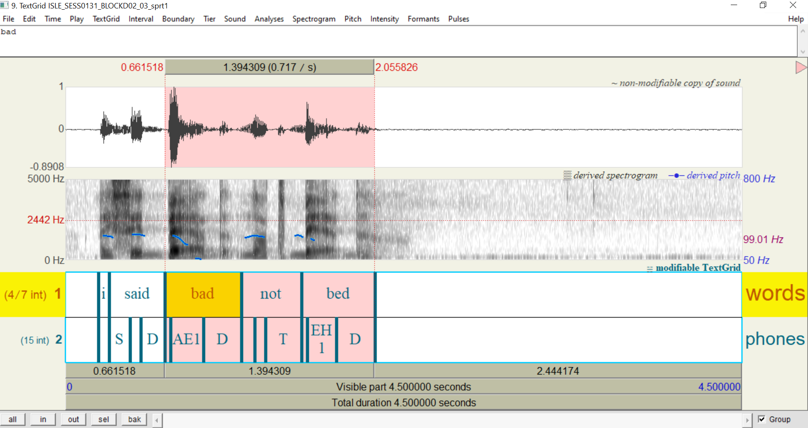

**GitHub:** [add your repository link here]  **Outputs (TextGrids):** [add your Drive link here]

## 1. Setup

Six utterances were aligned to their transcripts at word and phone level: three read-speech radio news recordings (`F2BJRLP1-3`, 25-31 s each) and three short ISLE learner-English sentences (about 4 s each; "I said white not bait", "I said new not no", "I said bad not bed"). I used MFA 3.4.4 with the pretrained `english_us_arpa` acoustic model and dictionary. Each output TextGrid has a words tier and a phones tier (ARPAbet with stress digits).

**Data preparation.** The radio recordings are NIST SPHERE files, which MFA cannot read, so they were converted to 16 kHz mono RIFF WAV. Transcripts were cleaned: lowercase, punctuation removed, hyphens replaced by spaces (`seventy- six`, `de-politicize`) and `S.J.C.` written as `S J C`.

**Custom dictionary.** `mfa validate` and a direct comparison against the dictionary showed five missing words: *dukakis, maffy, melnicove, politicize* and *wbur's*. I generated pronunciations with `mfa g2p` and checked them by hand. G2P treated *WBUR* as an ordinary word, which is wrong because the station name is spoken letter by letter, so *wbur's* was written manually as `D AH1 B AH0 L Y UW0 B IY1 Y UW1 AA1 R Z`. The other four G2P guesses were kept. Alignment used `mfa align --single_speaker`. The whole pipeline is in `run_pipeline.sh`.

## 2. Alignment visualization

The TextGrids were opened together with their WAV files in Praat. Each figure shows the waveform, the spectrogram with pitch track, the word tier and the phone tier. (Praat only draws the spectrogram for views of 10 s or less, so the long radio files are shown in zoomed windows.)

{width=6.3in}

{width=6.3in}

{width=6.0in}

{width=6.0in}

{width=6.0in}

## 3. Observations

**Boundaries are good overall.** In Figure 1 each word sits over its stretch of speech and the pause after "march" (about 12.6-13.0 s) is an empty interval. In the ISLE files the leading and trailing silences (e.g. 2.25-4.12 s in ISLE_01) are also left empty, and short gaps between words (e.g. between "white" and "not") appear as narrow empty intervals.

**Reduced and short sounds are the weak spot.** The statistics (`results/alignment_summary.csv`) show that 28 of the 308 phones in F2BJRLP1 (9%) last 30 ms or less, and similar shares in F2BJRLP2 (25 of 345) and F2BJRLP3 (23 of 372). Two are only 10 ms: the AH0 in *wbur's* (20.70 s, the vowel I added between B and L; the thin boxes between D and L in Figure 2) and the vowel in the short word *will* (23.44 s). Unstressed vowels in fast speech are often a few milliseconds long or barely present, while the model expects a longer vowel, so boundaries around them are the least trustworthy. The ISLE files, spoken slowly, have no phones this short (mean phone length about 130-140 ms versus about 73 ms in the radio files).

**Word-final stops absorb silence.** In ISLE_01 the T of "white" runs from 1.17 to 1.33 s (160 ms), but in the spectrogram the closure is silent and the release burst is near 1.30 s. MFA assigns the closure plus release to the final T. The same happens to the final D in "bad" and "bed" (250-260 ms). This is expected behaviour and means that stop durations from these alignments include the silent closure.

**Custom dictionary worked.** *wbur's* is aligned over 0.88 s with the letter-by-letter pronunciation and its edges match the energy in the waveform. Without the entry, the word would not be in the dictionary at all, and MFA would skip it or drop the utterance.

**Fit is worse on the learner speech.** MFA's quality metrics (`results/alignment_analysis.csv`) give a speech log-likelihood of -51.6 to -52.7 for the ISLE files against -45.1 to -47.2 for the radio files, even though the ISLE recordings are cleaner (SNR about 12 dB versus 8-10 dB). A likely reason is the accent and the pronunciation of the learner, which the native-English model fits less well. This was not tested further.

**Mismatches between transcript and speech.** The ISLE sentences are built on minimal pairs (white/bait, new/no, bad/bed), which are the places where a learner may say a different vowel or consonant than the one printed. Forced alignment cannot detect this: the aligner is given the transcript and always places those phones somewhere. A mismatch shows up only indirectly, as an unusually short or long phone, or poor local fit. I listened to all three ISLE recordings in Praat by playing each word interval. In every file the speaker says the printed words, including the contrast words (white/bait, new/no, bad/bed), so there is no mismatch between transcript and speech here and the alignments place the target words correctly (Figures 3-5). For example "bait" is B (40 ms), EY1 (210 ms), T (200 ms). Had the speaker said "white" in place of "bait", the aligner would still have fitted the phones of "bait" into that stretch, and the error would have been visible only by listening.

## 4. Extra credit

A custom dictionary with five manually reviewed entries for out-of-vocabulary words, and a single script (`run_pipeline.sh`) that runs the whole pipeline from the raw files to TextGrids, statistics and figures. A comparison with the `english_mfa` model was not done.
